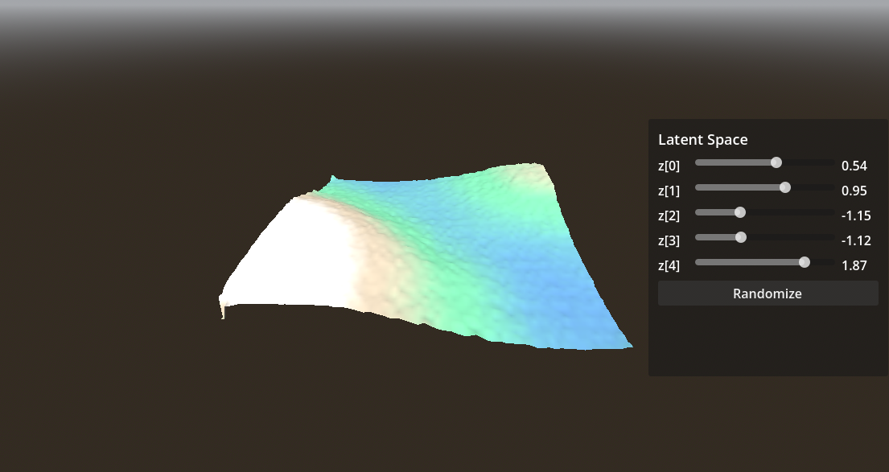
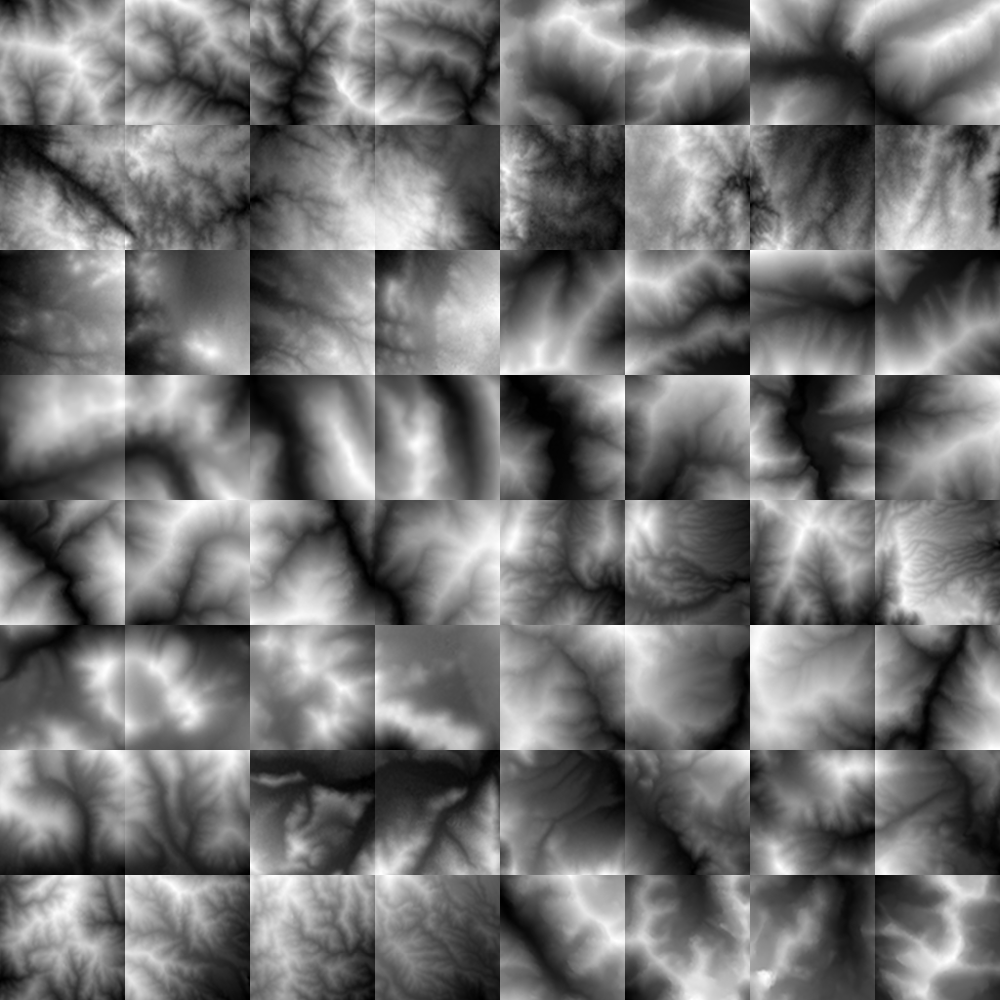
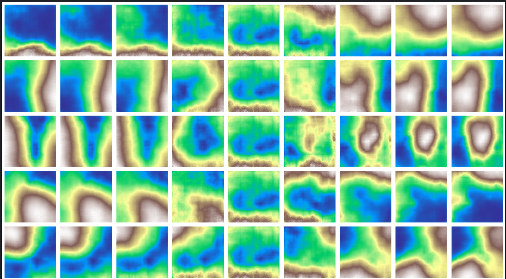
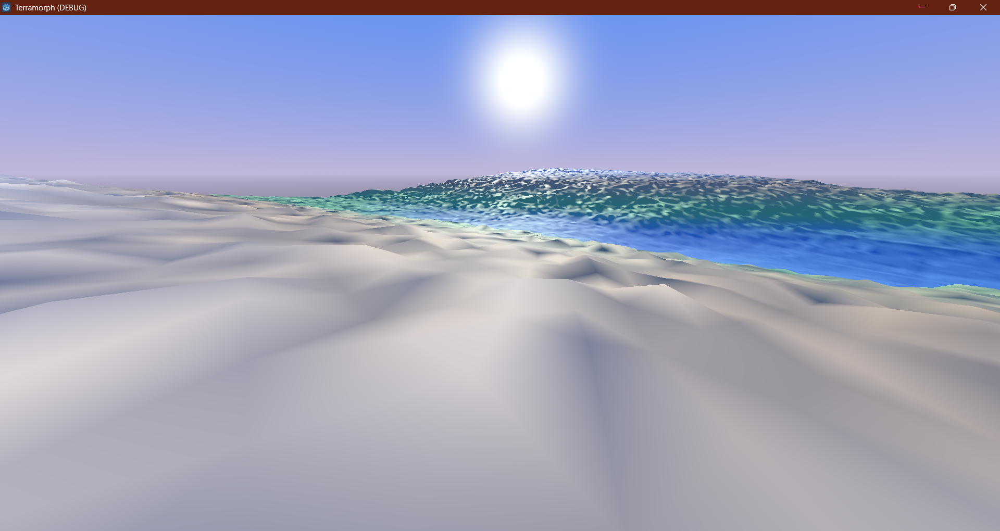

# Terramorph ,  Procedural Terrain Morphing with a VAE

> **Experiment 10** ,  College Stats/ML lab project.
> A Variational Autoencoder (**VAE** = **Variational Autoencoder**) trained on real-world
> elevation data, whose decoder runs **live inside Godot**: five latent sliders morph a
> 3D mountain landscape in real time, and you can walk through it in first person.



---

## 1. What is this project?

Most procedural terrain is either hand-authored or pure noise ,  it looks generic. Terramorph
takes a different route: it **learns** what real mountains look like from satellite elevation
data, compresses that knowledge into 5 numbers (the VAE's latent space), and then lets you
**sculpt terrain by sliding those numbers** inside a game engine.

Concretely:

- A **β-VAE** is trained on thousands of real mountain patches (Himalayas, Andes, Alps).
- Only the **decoder** is exported to ONNX ,  it maps a 5-number latent vector to a
  128×128 heightmap.
- Godot runs that decoder live (via the `godot-onnx` GDExtension) and displaces a 3D
  mesh on the GPU, so dragging a slider instantly reshapes the world.
- A custom shader adds mountain-shaping detail (sharp dendritic ridges, tree-like carved
  valleys), hypsometric coloring (water → grass → rock → snow), and a day/night cycle.
- A first-person **walk mode** lets you explore the 240-unit terrain on foot.

Each of the 5 sliders controls a *disentangled* terrain feature (that's what the β-VAE is
for) ,  e.g. one might raise overall elevation, another might switch ridge orientation , 
instead of all five doing random mush.

---

## 2. How it was made ,  the full pipeline

### 2.1 Dataset ,  `tile_scraper.py`

Real elevation data from **Mapzen Terrarium tiles** (`elevation-tiles-prod`), which encode
elevation in PNG pixels. The scraper:

1. Downloads tiles over mountainous bounding boxes
   (`--regions himalayas andes alps --zoom 12`).
2. Decodes RGB → metres with the Terrarium formula:
   `elevation = R × 256 + G + B / 256 − 32768`.
3. **Rejects flat tiles** (`min_patch_range` filter) ,  ocean and plains teach the VAE nothing.
4. Slices tiles into patches (64×64 first, **128×128** for the final model).
5. Saves `patches.npy` (float32), a `preview.png` contact sheet, and metadata.

The preview showed genuine branching ridge and drainage structures ,  exactly the features
we wanted the model to learn. Always inspect `preview.png` before training; if it's flat,
re-scrape with different regions.



```bash
python tile_scraper.py --regions himalayas andes alps --zoom 12 \
    --patch-size 128 --target-patches 4000 --max-tiles 3000 --out ./data128
```

### 2.2 Model ,  `terrain_vae_colab.py` (PyTorch Lightning, trained on Kaggle)

A convolutional **β-VAE**:

| Hyperparameter | 64px model | 128px model (final) |
|---|---|---|
| Latent dims | 5 | 5 |
| β (disentanglement weight) | 4.0 | 2.0 |
| KL warmup epochs | 15 | 15 |
| Learning rate | 1e-3 | 1e-3 |
| Batch size | 64 | 64 |
| Epochs (early-stopped) | 16 | ,  |

Deliberate trade-off: higher β gives **disentangled sliders** (each latent dim controls one
distinct terrain feature) at the cost of **blurrier reconstructions**. β=4 was chosen for
the 64px model for maximum slider separability; the 128px retrain used β=2 for sharper
detail while keeping the dims reasonably distinct.

Validation artifacts produced by the notebook:
- **Reconstruction check** ,  input vs. output patches side by side.
- **Per-dimension latent traversals** ,  sweeping each of the 5 dims while holding the rest
  at zero (this is exactly what the Godot sliders feel like).
- **`morph.gif`** ,  30-frame interpolation between two real terrains.



### 2.3 ONNX export ,  decoder only

The encoder is discarded; only the decoder ships to Godot. Hard-won export requirements:

- **Fixed input shape `(1, 5)`** ,  no `dynamic_axes`. A dynamic batch made DirectML crash
  inside ONNX Runtime on the `Reshape` node.
- **Explicit reshape** in the decode path: `h = self.vae.fc_decode(z).reshape(1, *conv_shape)`.
- **opset 18** ,  the opset-14 down-conversion failed; 18 exported and verified.
- **Single merged file** ,  Godot's ONNX importer ignores the `.onnx.data` sidecar, so the
  model is re-saved with `save_as_external=False` → `terrain_decoder.onnx`.
- Verified output shape: `(1, 1, 128, 128)`.

Place it at `res://models/terrain_decoder.onnx` and delete `.godot/imported/` to force a
clean reimport after replacing the model.

### 2.4 Godot integration ,  `godot/terrain_morpher.gd` + `godot/terrain.gdshader`

- **Inference**: `godot-onnx` GDExtension (Rust + ONNX Runtime; DirectML backend on
  Windows). Build requirements: Rust stable, Janet, MSVC toolchain , 
  `janet misc/build.janet`. The plugin's identity/matmul sample was verified before
  wiring in the real model. Enable the importer under **Project Settings → Plugins**.
- **Mesh**: self-built `ArrayMesh` grid (160×160 subdivisions over a 240×240 plane) with
  exact UVs, so the GDScript ground-height query matches the GPU displacement 1:1.
- **Heightmap**: decoder output → `Image.FORMAT_RF` float texture → vertex-shader
  displacement. (Feed it as a float texture, not 8-bit, or you'll get terracing.)
  Each inference's heightmap is normalized to 0–1 so every latent position gets the full
  water→snow palette.
- **Mountain shaping** (shader): domain-warped ridged multifractal for sharp dendritic
  crests, plus tree-like valley carving; thresholds and strength are live UI sliders
  (`sharp` 1.0–3.0, `ridge`, `groove`).
- **Lighting**: directional sun with shadows, procedural sky, time-of-day slider (0–24h)
  driving sun angle/color, sky colors, and ambient.
- **Walk mode**: mouse-captured first-person camera at head height, WASD/arrows to move,
  Space to jump, ESC to exit. The player follows a CPU mirror of the terrain height so it
  never clips through the surface. All shaping parameters live in GDScript as the
  **single source of truth** and are pushed to the shader ,  the two can never drift apart.



**Controls**: drag sliders to morph · left/right-drag orbits · wheel zooms · walk mode =
mouse-look + WASD + Space + ESC.

---

## 3. Timeline

| When (Oct 2026) | Milestone |
|---|---|
| Early | `tile_scraper.py` built; Terrarium tiles scraped (Himalayas/Andes/Alps, zoom 12); flat-tile filtering; `preview.png` shows real ridge/drainage structure |
| Early | β-VAE (64px, β=4) trained on Kaggle ,  16 epochs; reconstructions + 5-D traversals + morph GIF validated; blurrier output accepted for disentangled sliders |
| Early | Decoder-only ONNX export: opset-14 fails → opset 18 works; dynamic batch crashes DirectML → static `(1,5)`; merged single-file model |
| Early | `godot-onnx` built (`janet misc/build.janet`); sample verified (identity/matmul/benchmark) |
| Oct 3 | **First live 128px render in Godot** ,  five sliders morphing real terrain |
| Oct 3 | Mountain-shape UI added (sharpness/ridge/groove sliders); 128px retrain (β=2) for sharper detail |
| Oct 3 | Tree-valley shader work (`ridge_scale` 90 → 36 → 44) for dendritic drainage patterns |
| Oct 3 | Orbit camera + bean explorer rewrite (custom ArrayMesh grid replaces PlaneMesh) |
| Oct 3 | True first-person walk mode: captured mouse-look, WASD, jump, ESC; bean hidden (camera rides in the head) |
| Oct 3 | Kilometer scale-up: 240×240 plane, taller mountains, distance fog |
| Oct 3 | Fixed player falling through terrain ,  GDScript height mirror made single-source-of-truth |
| Oct 3 | UI polish: Space no longer triggers focused buttons (`FOCUS_NONE`), sidebar hidden in walk mode |
| Oct 3–4 | **The dimming saga**: terrain renders dark & murky; root cause found ,  inverted triangle winding (see §4.9); fixed winding + `cull_back` + sky ambient + rebalanced palette → bright vivid terrain |
| Oct 4 | This README compiled |

---

## 4. Major errors faced (and how they were fixed)

1. **Early stopping fired at epoch 16, every run.** It monitored `val_loss` while β was
   still warming up, so loss looked flat. Fix: monitor `val_recon` instead, patience 15.
2. **ONNX export failed at opset 14.** Kept opset 18 ,  exported and verified cleanly.
3. **DirectML crashed on the ONNX `Reshape` node.** Cause: dynamic batch axis. Fix: fully
   static graph, fixed `(1, 5)` input, explicit reshape, no `dynamic_axes`.
4. **Godot imported a broken/empty model.** Its importer ignores the `.onnx.data`
   sidecar. Fix: re-save merged with `onnx.save_model(m, path, save_as_external=False)`.
5. **Wrong property name** ,  `_env.bg_energy_multiplier` doesn't exist; it's
   `_env.background_energy_multiplier`.
6. **GDScript parse errors under warnings-as-errors.** `floor()`/`pow()` return
   `Variant`, so `:=` can't infer a type. Fix: explicit `: float` annotations.
7. **Player fell through the terrain.** The GDScript ground-height mirror still had the
   old `height_scale`/`ridge_scale` after the world was scaled up. Fix: GDScript owns
   every shaping parameter and pushes them all to the shader on ready ,  one source of
   truth.
8. **Spacebar toggled Walk mode.** Clicking the button gave it keyboard focus, so Space
   "pressed" it. Fix: `focus_mode = Control.FOCUS_NONE` on buttons.
9. **The terrain rendered dark and murky (the big one).** Root cause: the custom grid's
   triangles were wound `[a, c, b]` ,  back-facing from above in Godot's clockwise-front
   convention. With `cull_disabled`, Godot flips shader-written normals on backfaces, so
   every upward normal was inverted at render time: no sunlight, and sky ambient sampled
   the procedural sky's dark muddy ground hemisphere. (It also explained the "flipped
   map" screenshot ,  from below, those faces were front-facing and rendered bright.)
   Fix: winding `[a, b, c, b, d, c]`, `render_mode cull_back`, `AMBIENT_SOURCE_SKY` with
   0.6 contribution, ground-hemisphere colors tinted to match the horizon, normal
   epsilon tightened to `0.002`, and palette bands rebalanced. An earlier heightmap
   min/max normalization had only masked the symptom.
10. **Exponential fog washed out the terrain.** Replaced with depth-gated fog, then
    removed entirely per visual preference.

---

## 5. Results

- Real-time VAE terrain morphing in Godot: 5 disentangled latent sliders → 128×128
  heightmap → GPU-displaced 240-unit world, at interactive rates.
- Walkable first-person explorer with jumping, day/night cycle, and vivid hypsometric
  rendering (deep water → lush grass → warm rock → snow).
- Full pipeline proven end-to-end: real elevation data → β-VAE → ONNX → game engine.

---

## 6. Improvements for better terrain generation

**Model / training**
- Train at **256×256** for finer detail (needs more VRAM / longer Kaggle sessions).
- Add a **gradient/Sobel loss term** alongside MSE ,  MSE-only training blurs exactly the
  sharp ridges we care about; penalizing edge mismatch preserves them.
- **Bigger, more diverse dataset**: more ranges (Rockies, Caucasus, Southern Alps),
  multiple zooms, stricter relief filtering; ~10k+ patches.
- Experiment with **β schedules** (annealing) and slightly more latents (8) ,  5 was
  chosen for UI simplicity, not optimality.

**Realism**
- **Erosion simulation**: hydraulic/thermal erosion as a dataset preprocessing step (so
  the VAE *learns* eroded terrain) or as a GPU post-process on the decoded heightmap.
  This is the principled way to get true drainage networks instead of shader fakery.
- Replace/augment the hypsometric ramp with **slope-based texture splatting**
  (scree on steep slopes, grass on flats) and scatter trees/rocks procedurally.
- Animated **water plane** with reflections for the lowlands.

**Engine / scale**
- **Chunked LOD terrain** so the world can grow far beyond 240 units without a
  160×160-per-chunk cost explosion.
- Remove the heightmap min/max normalization (added as a debugging band-aid) and instead
  calibrate palette bands from **training-set statistics** ,  faithful *and* vivid.
- Named latent presets ("alpine", "canyon", "archipelago") as discoverable starting
  points instead of five abstract sliders.

---

## 7. Repo layout

```
.
├── tile_scraper.py          # Terrarium tile downloader → patches.npy + preview.png
├── terrain_vae_colab.py     # β-VAE training (PyTorch Lightning; run on Kaggle/Colab)
├── terrain_vae_colab.ipynb  # Notebook version of the above
├── godot/
│   ├── terrain_morpher.gd   # Main scene script: ONNX inference, UI, camera, player
│   ├── terrain.gdshader     # Vertex displacement + ridged detail + coloring
│   └── README.md            # Godot-side quick notes
├── models/                  # (not in repo) terrain_decoder.onnx ,  merged single file
└── README.md                # this file
```

**To run the Godot demo**: Godot 4.6+, `godot-onnx` addon installed
(`godot-onnx.gdextension` at project root, importer enabled), `terrain_decoder.onnx`
(single-file, weights merged) at `res://models/`. Attach `terrain_morpher.gd` to a
Node3D in an empty 3D scene and press F5.

**To retrain**: scrape patches → upload `terrain_vae_colab.py` + `patches.npy` to
Kaggle/Colab with a GPU → run all → export `terrain_decoder.onnx` per §2.3.

---

*Built by Soham (Infindev) ,  Experiment 10, October 2026.*
